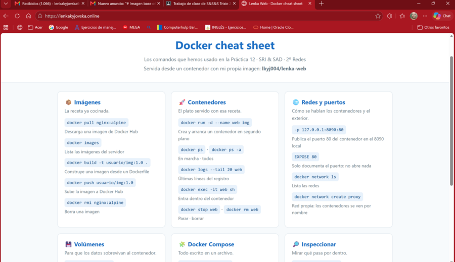
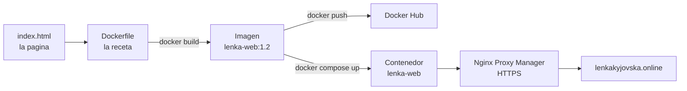

# 📦 web-lenka: mi primera imagen de Docker

> Una página web servida con **nginx** dentro de una imagen de Docker creada con un **Dockerfile**, publicada en **Docker Hub** y desplegada con **Docker Compose** detrás de **Nginx Proxy Manager** con HTTPS. La propia web lleva un **QR** que lleva a este repositorio.

Práctica 12 de *Seguridad y Servicios* (2º Redes, IES Politécnico Jesús Marín) · Autora: **Lenka Kyjovská**

🌍 **Web en directo:** https://lenkakyjovska.online
📦 **Imagen en Docker Hub:** https://hub.docker.com/r/lkyj004/lenka-web
🐘 **Mi segunda imagen (LAMP con base de datos y QR):** https://github.com/lkyjovska/practica12-lamp-docker



---

## 🧒 La explicación de la pizzería

| En la pizzería | En Docker | Qué significa |
|---|---|---|
| 📝 La **receta** | **Dockerfile** | Un papel que dice, paso a paso, cómo se hace el plato |
| 🍕 La pizza **ya hecha y congelada** | **Imagen** | El resultado de seguir la receta. Se puede guardar y repetir |
| 🍽️ La pizza **servida en la mesa** | **Contenedor** | La imagen funcionando de verdad |
| 📖 La **carta** del restaurante | **Docker Hub** | Donde se guardan las imágenes para que cualquiera las pida |
| 🛎️ El **recepcionista** | **Proxy (NPM)** | Recibe a los clientes y los manda a la mesa correcta |

## 🗺️ El recorrido



## 📁 Archivos

| Archivo | Qué es |
|---|---|
| [`Dockerfile`](Dockerfile) | La receta de la imagen |
| [`index.html`](index.html) | La página web (una chuleta de Docker) |
| [`docker-compose.yml`](docker-compose.yml) | Para desplegarla con un solo comando |

---

## 🚀 Paso a paso

### 1. Cuenta en Docker Hub e imagen base

**Docker Hub** es como una tienda de aplicaciones, pero de imágenes: de ahí se **descargan** las que ya existen y ahí se **suben** las nuestras. Se crea una cuenta gratuita en <https://hub.docker.com>; el nombre de usuario (`lkyj004`) forma parte del nombre de la imagen: `lkyj004/lenka-web`.

Nuestro Dockerfile parte de una imagen que ya existe (`nginx:alpine`). **No hace falta descargarla a mano**: la línea `FROM` la baja de Docker Hub al hacer el `build`. Aun así, se puede hacer con:

```bash
docker pull nginx:alpine
docker images
```

> 💡 La `nginx:alpine` original **queda intacta**. Nuestro Dockerfile le **añade capas** y el resultado es **otra imagen distinta**.

### 2. El Dockerfile, línea a línea

```dockerfile
FROM nginx:alpine
LABEL maintainer="Lenka Kyjovska" description="Web de la practica 12"
ENV TZ=Europe/Madrid
WORKDIR /usr/share/nginx/html
COPY index.html .
RUN echo "imagen construida el $(date)" > build-info.txt

# QR: enlace a GitHub con la explicacion de como se hizo
ARG GITHUB_URL=https://github.com/lkyjovska/web-lenka
RUN apk add --no-cache libqrencode-tools \
 && qrencode -s 8 -m 2 -o qr.png "${GITHUB_URL}"

EXPOSE 80
HEALTHCHECK --interval=30s --timeout=5s CMD wget -q -O /dev/null http://localhost/ || exit 1
```

| Instrucción | Qué hace |
|---|---|
| `FROM nginx:alpine` | Imagen base: un Linux muy ligero con el servidor web nginx ya instalado |
| `LABEL` | Autor y descripción |
| `ENV TZ=Europe/Madrid` | La zona horaria del contenedor |
| `WORKDIR` | La carpeta que nginx publica como web |
| `COPY index.html .` | Copia **nuestra página** a la imagen |
| `RUN echo ...` | Ejecuta un comando al construir: escribe la fecha de construcción |
| `ARG GITHUB_URL` | El enlace que llevará el QR (se puede cambiar al construir con `--build-arg`) |
| `RUN apk add ... qrencode` | Instala la herramienta del QR y **crea `qr.png` al construir la imagen** |
| `EXPOSE 80` | Documenta el puerto (no abre nada) |
| `HEALTHCHECK` | Cada 30 s comprueba que la web responde |

`FROM`, `WORKDIR`, `COPY` y `RUN` crean **capas** de la imagen. Las demás instrucciones solo añaden información.

### 3. Construir y subir la imagen

```bash
docker build -t lkyj004/lenka-web:1.2 .
docker login -u lkyj004
docker push lkyj004/lenka-web:1.2
```

`-t` pone nombre y versión (`usuario/nombre:etiqueta`) y el punto final indica que el Dockerfile está en la carpeta actual. La contraseña de `docker login` se escribe a mano y no se muestra.

### 4. Desplegarla con Docker Compose

```yaml
services:
  web:
    image: lkyj004/lenka-web:1.2
    container_name: lenka-web
    restart: unless-stopped
    networks:
      - proxy
networks:
  proxy:
    external: true
```

```bash
docker compose up -d
```

La imagen se descarga **de Docker Hub** y se conecta a la red `proxy`. En Nginx Proxy Manager, el host `lenkakyjovska.online` apunta a `http://lenka-web:80` con certificado de Let's Encrypt. NPM encuentra el contenedor **por su nombre** porque están en la misma red.

### 5. Actualizar a una versión nueva

Cuando cambia la página (o el Dockerfile) hay que construir una imagen nueva, subirla y **recrear** el contenedor.

> ⚠️ Un contenedor en marcha **sigue usando la imagen con la que nació**. Construir y subir la versión nueva no basta: hay que cambiar el compose y volver a hacer `up`.

```bash
cp index.html index.html.bak                      # copia de seguridad
docker build -t lkyj004/lenka-web:1.2 .           # imagen nueva
docker push lkyj004/lenka-web:1.2                 # subirla
sed -i 's#lenka-web:1.1#lenka-web:1.2#' docker-compose.yml
docker compose up -d                              # recrear el contenedor
docker inspect -f '{{.Name}} usa {{.Config.Image}}' lenka-web
```

Se recarga la página con `Ctrl+F5` para no ver la copia en caché.

### `EXPOSE` frente a `-p`

`EXPOSE` solo **documenta** el puerto. Para abrirlo de verdad hay que **publicarlo** con `-p`. Detrás de NPM no hace falta publicar nada: llega por la red `proxy`.

---

## 📚 Para saber más

- [Referencia de Dockerfile](https://docs.docker.com/reference/dockerfile/)
- [Docker Compose](https://docs.docker.com/compose/)
- [Nginx Proxy Manager](https://nginxproxymanager.com/)
- Chuleta de comandos y tutorial LAMP: https://github.com/lkyjovska/practica12-lamp-docker
